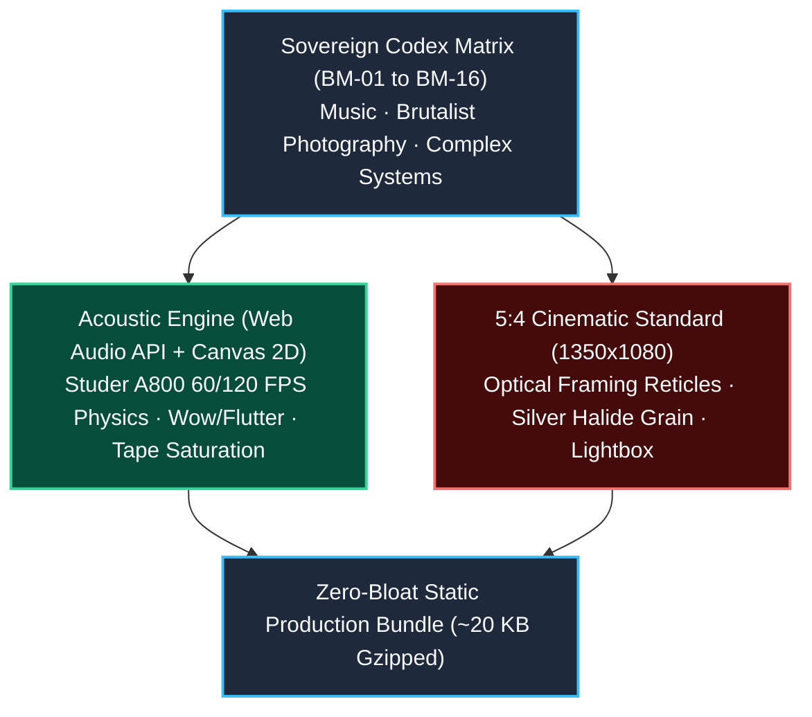

# BORJA MOSKV // Sovereign Codex

> **Avant-Garde Art, Sound Engineering, Studer A800 WebAudio Physics & Complex Systems Theory (`borjamoskv.com`).**

[](https://github.com/borjamoskv/borjamoskv-site/actions)
[](./LICENSE)
[](#6-build--local-inspection)

---

## ⚡ Quickstart & Installation

```bash
pnpm install
pnpm run dev
pnpm run build
```

---

## 1. Architecture & Editorial Philosophy



Constructed from the ground up following the **C5-REAL Sovereign Standards** and inspired by the brutalist editorial tradition of **Steidl** and **Peter Saville (Factory Records)**. The digital space rejects superficial ornamentation and corporate platform aesthetics, providing an uncompressed tactile environment for high-exergy research, sound, and visual art.

### Core Disciplines:
1. **MUSIC:** Dark Cyber-Flamenco, Deep Spatial Ambient, Botanical IDM (*Cactuses*), Microtonal Deconstructions, and Radiohead Re-interpretations (*This Was In Rainbows*).
2. **ART:** 35mm monochrome cinematic essays, large-format brutalist photography, lithographic codices, and satirical sequential art (*Cocodrilo*, *Choose Your Disorder*).
3. **COMPLEX SYSTEMS:** Informational thermodynamics, Chentsov uniqueness theorems, the 5 foundational error detectors, and the complete theoretical treatise *The Science of Friction* (PDF).

---

## 2. The Acoustic Machine: Reel-to-Reel Tape Deck

Integrated directly into the editorial grid, the custom **Canvas 2D + Web Audio API** engine replicates the physics and telemetry of a vintage studio tape deck (Studer A800 / Revox PR99):

* **Realtime Rotational Physics (60/120 FPS):** Dual aluminum 3-spoke flanges with authentic angular momentum, deceleration inertia, and dynamic tape pack winding thickness.
* **36-Mark Stroboscopic Disc:** Outer aluminum rim markings calibrated to produce a stroboscopic optical lock at 15 IPS tape speed.
* **Wow & Flutter Modulation:** Asymmetric dual LFOs (0.45 Hz and 4.8 Hz) modulating a sub-millisecond `DelayNode` to introduce organic speed micro-wander.
* **Harmonic Tape Saturation:** WaveShaper polynomial curve simulating magnetic core overload and warm analog tape compression (`TAPE SAT: [ON/OFF]`).
* **Dual Needle VU Meters:** Second-order ballistic needles monitoring channel peaks and RMS levels in real-time.
* **Autonomous Fallback Drone:** Generative analog drone synthesizer (55Hz / 82.5Hz with filtered magnetic hiss) for silent visual and theoretical codex entries.

---

## 3. The 5:4 Cinematic Standard

The right column utilizes a strict **5:4 aspect ratio** (1.25:1 · 1350×1080 px), matching the output of the native FFmpeg postproduction pipeline (`assemble_moby_54.py`):

* Precision optical framing reticles `+` in all four corners.
* Silver halide grain overlay and contrast grading.
* Full-screen interactive **Lightbox Modal** with deep backdrop blur.

---

## 4. Canonical Discography & Works (BM-01 to BM-16)

| ID | Title | Discipline | Format / Link |
| :--- | :--- | :--- | :--- |
| `BM-01` | **THIS WAS IN RAINBOWS** | IDM / Radiohead Deconstruction | [Bandcamp LP](https://borjamoskv.bandcamp.com/album/this-was-in-rainbows) |
| `BM-02` | **CACTUSES** | Botanical Minimal Synth / Desert IDM | [Bandcamp 23-Track](https://borjamoskv.bandcamp.com/album/cactuses-2) |
| `BM-03` | **MIARMA** | Contemplative Club / Microhouse | [Bandcamp EP](https://borjamoskv.bandcamp.com/album/miarma) |
| `BM-04` | **LO INMANENTE** | Downtempo / Consciousness Archaeology | [Bandcamp Suite](https://borjamoskv.bandcamp.com/album/lo-inmanente) |
| `BM-05` | **[B]** | Dark Disco / Electronic Decay | [Bandcamp EP](https://borjamoskv.bandcamp.com/album/b) |
| `BM-06` | **FARÁNDULA** | Cultural Satire / Broken Flamenco | [Bandcamp LP](https://borjamoskv.bandcamp.com/album/far-ndula) |
| `BM-07` | **ANTES DE LAS GUERRAS** | Dark Cyber-Flamenco / Sub-bass | Master Tape Direct |
| `BM-08` | **INDUSTRIAL REICH & PHANTOM SOUND**| Cinematic Essay / 35mm Grain Film | Archival Negative |
| `BM-09` | **THE DISPLACEMENT OF FORM** | Brutalist Photography / Spatial Mass | Large-Format Gelatin |
| `BM-10` | **THE ARCHIVE OF SUBTLETY** | Visual Codex / Lithographic Plates | Limited Folio Box |
| `BM-11` | **COCODRILO** | Narrative Art / Illustrated Volume | Screenprinted Edition |
| `BM-12` | **CHOOSE YOUR DISORDER** | Satirical Graphic Essay / Underground | Lithographic Broadside |
| `BM-13` | **THE SCIENCE OF FRICTION** | Physics & Information Theory | [Treatise PDF (3.5MB)](/ciencia_friccion_libro.pdf) |
| `BM-14` | **BABYLON-60 & SOVEREIGN EXERGY** | Ring-0 Kernel Architecture | Formal Verification |
| `BM-15` | **THE FIVE APHORISMS** | Epistemic Invariants & Dialectics | Constitutional Axioms |
| `BM-16` | **AUTOPOIESIS & COGNITIVE CLOSURE** | Cybernetics & Information Geometry | Topological Field |

---

## 5. Keyboard Navigation & Tactical HUD

* `[← / →]` : Previous / Next Codex Entry.
* `[Space]` : Play / Pause tape transport.
* `[C]` : Open searchable Catalogue Drawer (16 works).
* `[M]` : Open C5-REAL Soteric Transduction Manifesto.
* `[B]` : Open inline Treatise PDF Viewer (*The Science of Friction*).
* `[Esc]` : Close active modal/lightbox.
* **Brutalist HUD Toast:** Instant physical feedback in the bottom-right corner for all transport and navigation actions.

---

## 6. Build & Local Inspection

```bash
# Install dependencies
pnpm install

# Run development server
pnpm run dev

# Compile strict production build
pnpm run build

# Preview production artifacts
pnpm run preview
```

* Zero heavy runtime dependencies.
* Build time: `< 300 ms`.
* Bundle payload: `~73 KB` JS *(~20 KB gzipped)*.

---

## 7. License & Security

Engineered by **Borja Moskv** (`@borjamoskv`). Code architecture licensed under **MIT** (`LICENSE`); musical works, visual plates, and *The Science of Friction* retain full artistic copyright. Security disclosures and contribution protocols follow `SECURITY.md` and `CONTRIBUTING.md`.
